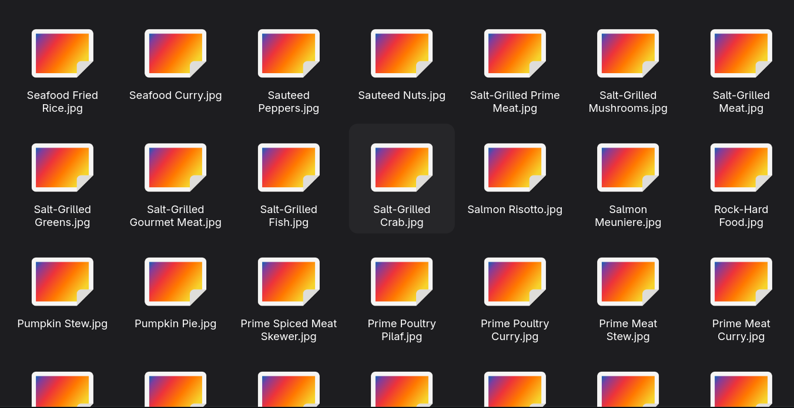

# Image Downloader

This is a Python script that automatically downloads all images from a webpage.



## Description

It includes simple filters to avoid downloading small icons or avatars, and it renames the image files.

## Features

* Supports lazy loading by checking both standard and dynamic image sources.
* Skips small system icons and avatars to keep only the recipe images.
* Changes symbols and spaces in names to avoid file saving errors.
* Uses custom headers to avoid being blocked by the website.

## Requirements

You need Python 3 installed on your computer. You also need to install two external libraries before running the code:

* Requests (to download the webpage and the images)
* BeautifulSoup4 (to read and parse the HTML code)

You can install both dependencies by running this command in your terminal:
```bash
pip install requests beautifulsoup4
```

## How to Use

1. Put the `main.py` file in your project folder.
2. Open your terminal or command prompt in that folder.
3. Run the script with the following command:
    ```bash
    python main.py
    ```
4. The script will create a new folder called `img` and save all the recipe images inside it.

## How to Create an Executable

If you want to create a standalone executable file so you can run it without Python installed, follow these steps:

1. Install PyInstaller using pip:
    ```bash
    pip install pyinstaller
    ```
2. Convert the script into a single executable file:
    ```bash
    pyinstaller --onefile main.py
    ```
3. Once the process finishes, you can find the final file inside the `dist` folder.
